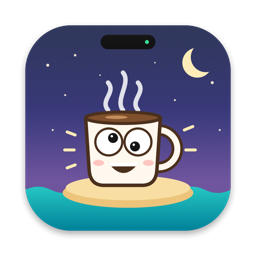
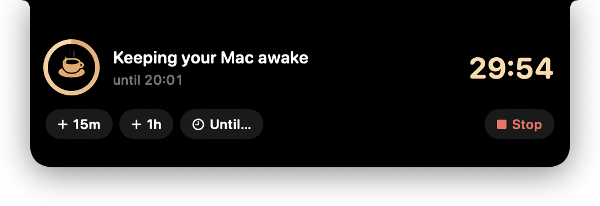

<p align="center">
  
</p>

<h1 align="center">Dynamic Caffe Island</h1>

<p align="center">
  Keep your Mac awake — from a Dynamic Island.<br>
  Even if your Mac has no notch. Free, open source (MIT), Intel + Apple silicon.
</p>

<p align="center">
  
</p>

## Features

- **A notch on every Mac.** A black island hangs from the top of the screen: it
  wraps the real notch on notched MacBooks and simulates one everywhere else.
- **Keep awake in one hover.** 15 min, 30 min, 1 h, 2 h, ∞ or **until a
  specific time** (a time already passed today means tomorrow). `+15m` / `+1h`
  while running, one-click **Stop**.
- **Live countdown** in the island and the menu bar — and, when idle, how long
  until the screensaver / display sleep.
- **Spotlight, Siri & Shortcuts** actions: *Keep Mac Awake*, *…for Minutes*,
  *…Until*, *Let Mac Sleep*.
- **Automation**: global hotkey <kbd>⌃⌥C</kbd>, `caffe://` URLs, and a tiny
  `caffe` CLI.
- **Tiny footprint**: under 1 % CPU, ~15 MB RAM, no network, no special
  permissions. Uses the same power-assertion mechanism as `caffeinate`.
- English and French ([add your language](docs/LOCALIZATION.md)).

📖 **[User manual](docs/manual/index.html)** (English / Français)

## Install

Download the latest `.dmg` from **Releases**, drag the app to Applications and
launch it. Requires macOS 13 Ventura or later; one universal binary for Intel
and Apple silicon.

Or build it yourself:

```bash
brew install xcodegen
scripts/build-release.sh --install     # universal Release build → /Applications
```

## Use it from anywhere

```bash
caffe 45                                # 45 minutes   (scripts/caffe)
open -g "caffe://until?time=19:45"      # until 19:45
open -g "caffe://stop"
```

| URL | Action |
|---|---|
| `caffe://start?minutes=N` · `caffe://N` | Keep awake N minutes (1–1440) |
| `caffe://until?time=HH:MM` · `caffe://until/HHMM` | Until a time of day |
| `caffe://indefinite` | Until stopped |
| `caffe://stop` · `caffe://toggle` | Stop · toggle 30 min |
| `caffe://peek` · `caffe://pick` | Open the island · open the Until window |

## Develop

```bash
xcodegen generate                       # DynamicCaffeIsland.xcodeproj (git-ignored)
swift test --package-path Packages      # unit + contract tests
scripts/e2e.sh                          # end-to-end test of the installed app
python3 scripts/i18n-check.py           # localization lint
```

CI builds and tests natively on Intel and Apple silicon for every push. Pushing
a `v*` tag builds one universal binary, smoke-tests it on both architectures
and publishes a DMG + ZIP release. See [CONTRIBUTING.md](CONTRIBUTING.md).

## License

[MIT](./LICENSE)
